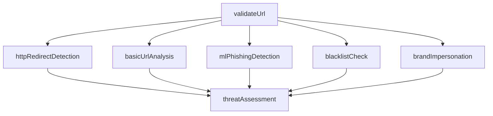
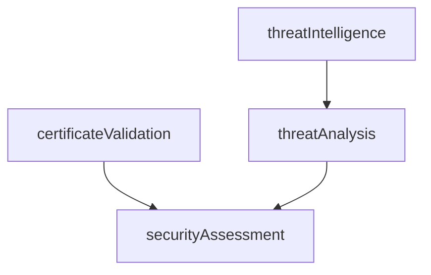

# Threat-analysis server

Express + TypeScript with the real Engine 1 threat-detection pipeline. Analysis
validates URLs, follows HTTP redirects with SSRF protections, extracts URL signals,
runs local pretrained ML and brand impersonation detection, and produces a final
rule-based assessment. There is no database.

```sh
pnpm install
pnpm ml:download
pnpm dev
```

Defaults to port `3000` (override with `PORT`). The verified model is loaded once
before listening. Missing/corrupt model files fail startup; they are never downloaded
or silently skipped at runtime. To use an already-provisioned copy, set
`PHISHING_ONNX_MODEL_PATH` to its local filename. `SIGINT`/`SIGTERM` stop new requests,
drain in-flight work, and dispose the native model.

- `GET /health`
- `POST /api/analyze` — accepts `{ "url": "https://example.com/" }` and returns real pipeline results.
- There is no `/analyze` alias.

```sh
curl -X POST http://localhost:3000/api/analyze \
  -H 'Content-Type: application/json' \
  -d '{"url":"https://example.com"}'
```

### HTTP analysis contract

`POST /api/analyze` requires `Content-Type: application/json`, a body of at most
16 KB, and an explicit HTTP(S) URL of at most 8,192 characters without credentials.
Invalid input is rejected before any detector/network/provider call. Extra body
fields do not configure detectors: all options are server-owned.

HTTP 200 returns the seven task outputs keyed by name:

- `validateUrl`: normalized URL and original input.
- `httpRedirectDetection`, `basicUrlAnalysis`, `mlPhishingDetection`,
  `blacklistCheck`, `brandImpersonation`: `{ module, status, evidence, details, issues }`.
- `threatAssessment`: `{ policyVersion, riskLevel, summary, findings, incompleteModules }`.

The standard entry point (`src/index.ts`, configured by `src/server-options.ts`)
explicitly selects the pretrained ONNX model, 82-brand Zenodo catalog, and Google
Safe Browsing blacklist provider when a Google API key is set. Google matches are trusted by the
server's assessment policy and can produce high-risk findings. API failures/timeouts
remain `unknown`/incomplete, not an all-clear. To configure feeds or providers programmatically, call
`createApp(options)` with `ThreatDetectionPipelineOptions`; the factory uses the
supplied configuration and does not load/select a model or catalog itself.

| HTTP status | Meaning |
| --- | --- |
| 200 | Pipeline completed, possibly with missing configuration or failed network/provider checks explicitly listed |
| 400 | Invalid URL/request shape or malformed JSON |
| 413 | Body exceeds 16 KB |
| 415 | Unsupported content type, charset, or body encoding |
| 500 | Unexpected detector/engine failure; no fabricated result |

Errors are JSON `{ "error": { "code": "...", "message": "..." } }`, without raw
exceptions, secrets, or stack traces. Expected redirect/provider failures remain
HTTP 200 with incomplete evidence so assessment can still run. Results can contain
the submitted URL/path/query: treat them as sensitive and do not indiscriminately log
or expose them. Risk levels are indicators, not safety guarantees.

**This endpoint now makes outbound HTTP/DNS requests** via the protected redirect
detector. Private/loopback/reserved targets are blocked rather than fetched. Keep
production egress restrictions, authentication, request/concurrency limits, and TLS
at the deployment boundary; an unauthenticated public scanner can be abused. No
URL is submitted to Hugging Face. **The standard server sends the submitted URL,
including path/query (excluding fragments), to Google when Safe Browsing is configured.** Do not
submit private URLs or secret-bearing query strings unless sharing them is acceptable.

### Google Safe Browsing server configuration

**Non-commercial use only.** Safe Browsing is free within its allocated quotas,
unlike the billing-enabled Web Risk product. Commercial/revenue-generating deployments
must not use this integration under the free Safe Browsing terms.

1. Create/select a Google Cloud project and enable the **Safe Browsing API**
   (`safebrowsing.googleapis.com`). No paid Web Risk API is required.
2. Create a server-side API key and restrict it to Safe Browsing API (and your server's
   egress IPs where possible). An existing Google key can be reused if its restrictions
   allow Safe Browsing. This integration uses API-key authentication, not ADC.
3. Export it before starting the server:

```sh
GOOGLE_SAFE_BROWSING_API_KEY='your-key' pnpm dev
```

Without a Google key, startup warns and blacklist checks remain
`not_configured`/`unknown`. There is no keyless Google mode or automatic PhishTank
fallback. Empty/whitespace-containing keys fail startup. `.env.example` documents the
variables; `pnpm dev` and `pnpm start` load `server/.env` if present, using Node's
built-in environment-file support. Exported variables take precedence. Restart the
server after editing `.env`. Keys and provider response bodies are not
returned to clients. No provider credentials/options are accepted from request bodies.
Keys use the `x-goog-api-key` HTTP header, not the query string. Requests use Google's
Safe Browsing v4 Lookup API (`POST /v4/threatMatches:find`) with `SOCIAL_ENGINEERING`,
`MALWARE`, `UNWANTED_SOFTWARE`, `ANY_PLATFORM`, and `URL`, with a 5-second deadline.
Neither PhishTank nor Web Risk is registered by server startup; their library
factories remain available for explicitly configured callers.

Optional `GOOGLE_SAFE_BROWSING_ADDRESS_FAMILY=4` or `6` selects a DNS address family
for the fixed Google endpoint only. Leave it unset normally. This environment has
a slow IPv4 path to Google, so `6` avoids that route without changing redirect
detection, global DNS/fetch, TLS hostname verification, or the five-second deadline.
The old `GOOGLE_WEB_RISK_API_KEY` and `GOOGLE_WEB_RISK_ADDRESS_FAMILY` variables
remain migration aliases; the Safe Browsing names take precedence. These aliases
never enable calls to Web Risk. Your existing `.env` can therefore continue working.

To inspect blacklist results:

```sh
curl -sS http://localhost:3000/api/analyze \
  -H 'Content-Type: application/json' \
  -d '{"url":"https://example.com/"}' | jq '.blacklistCheck, .threatAssessment'
```

`matched` means Google returned a requested threat type; the response's `details`
lists validated threat categories and the required Google advisory, not raw Google
payloads. An empty JSON response `{}` or empty `matches` array means `no_match`,
**not safe**. Network errors, quota/auth failures (including
HTTP 429), timeouts, and invalid responses yield `unknown` plus issues. There are
no retries or result caches; Google's match cache durations are validated but results
are not retained for reuse.

**Client/display obligations:** Before a user enables protection, explain that
both false positives and false negatives are possible; this service cannot guarantee
accuracy or completeness. For warnings based on a Safe Browsing match, use qualified
language such as "potentially unsafe" and display **Advisory provided by Google**
linked to https://developers.google.com/safe-browsing/v4/advisory. Match `details`
include that text/link and educational links for phishing/malware/unwanted software.
The consuming UI must actually render them; do not attach Google attribution to
ML, brand, other blacklist sources, or negative checks. Do not show stale warnings.

Review Google's [usage restrictions and warning requirements](https://developers.google.com/safe-browsing/v4/usage-limits)
and [Lookup documentation](https://developers.google.com/safe-browsing/v4/lookup-api).
Monitor project quotas; HTTP 429 remains inconclusive. Only the submitted URL is
checked, not each redirect destination. No API key is bundled with the project.

For HTTP regression tests (loopback requests only; detector network I/O is stubbed):

```sh
pnpm exec tsx --test test/app.test.ts
```

## Structure

```text
src/
  app.ts                     Express routes
  index.ts                   Server entry point
  pipeline/                  Reusable execution engine
    task.ts                  Task definitions and handlers
    dag.ts                   Dependency graph and validation
    scheduler.ts             Readiness checks and failure blocking
    executor.ts              Task invocation and output/error capture
    state-manager.ts         Per-run task states and errors
    execution-context.ts     Shared input and results for one run
    pipeline-runner.ts       Concurrent execution coordination

  pipelines/                 Business-specific pipeline definitions
    mock-pipeline.ts         Security DAG factory with mock analysis tasks
    threat-detection-pipeline.ts  Engine 1 validation, five detectors, final assessment
  tasks/threat-detection/     One execution-context handler per Engine 1 task
  modules/threat-detection/   Generic contract, shared URL helpers, and one folder per detector
test/                        DAG engine and security pipeline tests
```

## Engine 1 threat-detection modules

Independent URL analyzers are available in [`src/modules/threat-detection`](src/modules/threat-detection/README.md): HTTP redirects, basic URL analysis, ML model inference, blacklist checking, and brand/domain impersonation. The linked guide describes libraries, configuration, security boundaries, model requirements, and usage. These modules power `/api/analyze` and can also be used independently. The library/pipeline defaults remain explicit: ML requires a supplied trained model; blacklists require configured snapshots/providers; brand detection requires an official-domain catalog.

The standard HTTP server uses `createGoogleSafeBrowsingProvider({ apiKey })` when
configured. Independent checker/graph callers must still opt in through
`blacklist.providers`. `createPhishTankProvider` and `createGoogleWebRiskProvider` remain optional library
alternative, not a server default. Keep credentials server-side; see the
[Safe Browsing provider guide](src/modules/threat-detection/README.md#google-safe-browsing-provider).

An opt-in pretrained ML model is available: the MIT-licensed
`pirocheto/phishing-url-detection` Linear SVM. Run `pnpm ml:download`, load it with
`await loadPretrainedMlPhishingModule()`, then pass the instance as `mlModule` to
`buildThreatDetectionPipeline`. Inference runs locally on CPU using the pinned ONNX
graph; no URL is sent to a hosted service. Existing `mlModel` logistic artifacts and
unconfigured defaults remain supported. See [setup, provenance, license, and limitations](models/phishing-url/README.md).

### Engine 1 DAG and handlers

[`buildThreatDetectionPipeline(options)`](src/pipelines/threat-detection-pipeline.ts) builds a fresh DAG without executing it. The seven handlers live in [`src/tasks/threat-detection`](src/tasks/threat-detection/index.ts), separate from the detector modules and graph definition.



`validateUrl` accepts `{ url: string }`, applies the shared strict HTTP/HTTPS parser, rejects embedded credentials, and returns `{ url, originalUrl }`. Every detector declares this dependency. Most handlers use the serialized `url`; basic URL analysis uses `originalUrl` so normalization cannot erase unusual IPv4 spelling. Invalid input fails validation and blocks all five detectors before any network/provider call. Valid input fans out to all detectors concurrently; there are no artificial dependencies between independent checks.

All detector classes implement [`ThreatDetectionModule<TInput, TOutput>`](src/modules/threat-detection/contracts/module.ts), with a `name` and typed `analyze(input)` method. Each detector folder separates public exports, result types, functional analysis, and class configuration. The detector classes return `ModuleResult<TDetails>`: `{ module, status, evidence, details, issues }`. Typed evidence codes describe observations without assigning threat severity. Raw detector diagnostics remain available under `details`. The final `ThreatAssessment` class runs plain rules over the evidence to produce a report.

| Task/result key | Handler |
| --- | --- |
| `validateUrl` | `handleValidateUrl` |
| `httpRedirectDetection` | `createHttpRedirectHandler(options)` |
| `basicUrlAnalysis` | `handleBasicUrlAnalysis` |
| `mlPhishingDetection` | `createMlPhishingHandler(model)` |
| `blacklistCheck` | `createBlacklistHandler(options)` |
| `brandImpersonation` | `createBrandImpersonationHandler(options)` |
| `threatAssessment` | `createAssessmentHandler(options)` |

```ts
import { PipelineRunner } from './src/pipeline/pipeline-runner.js';
import { buildThreatDetectionPipeline } from './src/pipelines/threat-detection-pipeline.js';

const dag = buildThreatDetectionPipeline({
  redirects: { maxRedirects: 10, timeoutMs: 5_000 },
  blacklist: {
    snapshots: [{
      source: 'application-managed-feed',
      updatedAt: '2026-11-01T00:00:00Z',
      domains: ['known-bad.example'],
    }],
  },
  brandImpersonation: {
    brands: [{ name: 'PayPal', domains: ['paypal.com', 'paypal.co.uk'] }],
    maxEditDistance: 1,
  },
  // Supply mlModel with your own evaluated LogisticUrlModel artifact to enable predictions.
});
const runner = new PipelineRunner(dag);
const results = await runner.run({ url: 'https://example.com' });
// results.validateUrl, results.httpRedirectDetection, results.basicUrlAnalysis,
// results.mlPhishingDetection, results.blacklistCheck, results.brandImpersonation
// results.threatAssessment: { policyVersion, riskLevel, summary, findings, incompleteModules }
```

**Running this DAG performs redirect network I/O by default.** The other four checks analyze the submitted URL, not its redirect destinations. For offline tests, inject `redirects.transport`. The graph factory itself performs no network calls. Configuration is captured when handlers are created; build a new graph to refresh models, feeds, or brand catalogs. A runner can be reused for concurrent requests with isolated execution state.

Unconfigured ML, absent/empty blacklist feeds, and an empty brand catalog return `not_configured` envelopes. Operational failures return `error` or `partial` results, so assessment still runs and lists incomplete checks. Unexpected handler exceptions still fail the run rather than being silently treated as negative checks. Rules assign `info | medium | high` finding severity, with overall `unknown | low | medium | high` risk. No numeric score or safe verdict is generated.

Use `assessment: { trustedBlacklistSources: ['application-managed-feed'] }` only for sources you deliberately trust and maintain. A trusted blacklist match can produce a high-severity finding; untrusted matches are medium. Brand resemblance plus authentication terms/model evidence on the same hostname and target can produce a medium-severity finding. Source freshness and model quality remain caller responsibilities. See the [assessment rules and migration guide](src/modules/threat-detection/assessment/README.md).

**Migration:** `/api/analyze` now returns the seven real Engine 1 outputs instead of
the four mock security-task results. Class/DAG detector outputs are wrapped under
`.details`; plain analyzer functions still return raw outputs. Basic URL signals
do not have a `severity` property; use `threatAssessment` for the final report.

```sh
pnpm exec tsx --test test/threat-detection-pipeline.test.ts
```

## Legacy mock security pipeline (library only)

The legacy factory remains available for engine examples/tests but is no longer
connected to the HTTP API. It returns a fresh graph containing four mock tasks;
it does not execute them.



`certificateValidation` and `threatIntelligence` can run concurrently. `threatAnalysis` reads the intelligence output, and `securityAssessment` waits for both certificate validation and threat analysis before combining their outputs. Everything in this legacy graph is local mock data: the submitted URL is not fetched or analyzed. Its mock score is 25 per intelligence match, capped at 100; it is not a real risk score and is not returned by the real HTTP API.

### Test the mock pipeline

Run these commands from `server/` (after `pnpm install` if dependencies are not installed):

```sh
# Focused tests: graph, execution order, dependency data flow, and isolated runs
pnpm exec tsx --test test/security-pipeline.test.ts

# Full test suite and TypeScript checks
pnpm test
pnpm typecheck
```

The data-flow test replaces the two root task outputs with an invalid certificate and one mock intelligence match. It checks that downstream tasks produce a score of `25`, a `suspicious` verdict, and two findings.

```ts
import { PipelineRunner } from './src/pipeline/pipeline-runner.js';
import { buildSecurityPipeline } from './src/pipelines/mock-pipeline.js';

const dag = buildSecurityPipeline();
const runner = new PipelineRunner(dag);
const result = await runner.run({ url: 'https://example.com' });
```

The server constructs one runner per app and reuses it across requests, with isolated execution state for each run.

## DAG pipelines

```ts
import { DAG } from './src/pipeline/dag.js';
import { PipelineRunner } from './src/pipeline/pipeline-runner.js';
import { Task } from './src/pipeline/task.js';

const dag = new DAG([
  new Task({ name: 'source', run: (context) => context.input }),
  new Task({
    name: 'summary',
    dependencies: ['source'],
    run: (context) => ({ source: context.results.source }),
  }),
  new Task({ name: 'independent', run: async () => 'runs alongside source' }),
]);
const pipeline = new PipelineRunner(dag);

const results = await pipeline.run({ url: 'https://example.com' });
```

`DAG` stores tasks by their unique `Task.name` identifiers. Use `new DAG()` and `register(task)` to build a graph incrementally, or pass an initial task array. `getTask(name)` retrieves a task and `getDependencies(name)` returns its dependency names. Duplicate registrations throw rather than overwrite a task. Call `validate()` after registration to check for missing references and circular dependencies.

`Scheduler(dag, state)` is created separately for each run. `getReadyTasks()` returns only pending tasks whose dependencies have all succeeded, using the DAG's dependency lookups. It also marks tasks blocked by failed prerequisites, including transitive dependents.

Registration order does not matter. Dependencies refer to task names; the runner calls `validate()` when constructed, before any task executes. Each task is scheduled once per pipeline run, after all its dependencies succeed; its handler can be attempted multiple times if retries are configured. Independent asynchronous tasks run concurrently in the same process. A newly ready task starts without waiting for unrelated running tasks. This does not provide CPU parallelism or a concurrency limit.

Each run creates its own `StateManager`, `Scheduler`, and `ExecutionContext(input, state)`, so the same runner can handle concurrent requests. Execution uses `state.allTasksFinished()` to detect completion, including failed and blocked tasks. When nothing new is ready, the runner awaits the next running task rather than polling. Handlers receive `context.input`, `context.state`, and `context.results`; a successful return value is stored under the task's name, including `undefined`. Declare every dependency whose output you read. Prefer returning an output rather than mutating other tasks' entries, since independent handlers share the context. Inputs and returned values are not deep-cloned.

`StateManager.initialize(dag)` resets the per-run statuses, stored results, and errors. `markRunning(name)`, `markSuccess(name, result)`, `markFailed(name, error)`, and `markBlocked(name)` record transitions. `getResult(name)` retrieves a successful task's returned value, and `isSuccess(name)` checks its status. The executor also publishes successful outputs to the shared context for downstream handlers.

States begin at `PENDING` and change to `RUNNING`, then `SUCCESS` or `FAILED`. When a prerequisite fails or is blocked, its pending dependents become `BLOCKED` and are never invoked. Unrelated branches continue. On success, `run()` returns the context's results record directly. On failure, it waits for all executable work to finish and then rejects with the first recorded task error. A run with no tasks returns `{}`.

Task handlers can inspect per-run states, stored outputs, and original errors through `context.state.getStates()`, `getResult(name)`, and `getErrors()`.

`Executor.execute(task, context, state)` marks the task running, awaits its handler (including any configured retries), and records its output or terminal failure. On terminal failure it rethrows the error after updating state. The runner catches these errors while draining independent work, then rejects the run. There is no persistence or rollback of context mutations. The Express example's response shape is unchanged; pipeline errors propagate to Express.

## Automatic retries

Retries are opt-in per task. Existing tasks without a retry policy still get one attempt.

```ts
new Task({
  name: 'lookup',
  retry: {
    maxRetries: 2,       // Two retries after the initial attempt: three attempts total
    initialDelayMs: 100,
    maxDelayMs: 1_000,
    shouldRetry: (error) => error instanceof Error && error.message === 'temporary failure',
  },
  run: async (context) => {
    // Replace this body with your operation; throw on failure to trigger retries.
    return context.input;
  },
});
```

- `maxRetries` is required when configuring retries and must be a non-negative safe integer.
- `initialDelayMs` defaults to `100`; `maxDelayMs` defaults to `30000`. Delays double after each retry, capped at `maxDelayMs`, without jitter. For example, initial `100` and cap `250` produce waits of `100`, `200`, `250`, `250`, … milliseconds.
- Both delays must be integers from `0` through `2147483647`, and the initial delay must not exceed the cap. A zero initial delay schedules retries on subsequent timer turns without increasing the delay.
- `shouldRetry` is an optional synchronous predicate. Without it, all handler errors are eligible for retry. Returning `false` stops retries immediately. If the predicate throws, its error becomes the terminal failure.
- A task stays `RUNNING` throughout retry attempts and backoff. Its dependents stay pending, and unrelated branches can continue. Only a successful attempt publishes a returned output; only terminal failure records an error and blocks descendants. When attempts are exhausted, the last handler error is retained and rethrown.
- Attempts use the same execution context and original input. Retry counts and delays are local to each execution, including concurrent runs on a shared runner. Retry configuration is copied and frozen when constructing a task.
- Retries do not roll back shared-context mutations or external side effects. Return outputs rather than mutating shared results during attempts, and use idempotency protection for operations that write externally. Retries do not provide task timeouts or cancellation.

Run the retry tests from `server/`:

```sh
node --import tsx --test test/retry.test.ts
```

These tests cover recovery, exhaustion, retry filtering, capped backoff, configuration validation, dependency blocking, independent work, and isolation between runs.


```sh
pnpm typecheck
pnpm test
pnpm build
pnpm start
```
