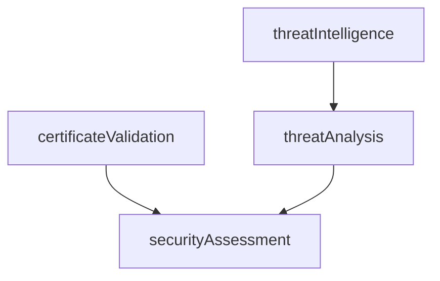

# Xerxes server

Express + TypeScript with a DAG execution engine, [Module 1 URL analyzer](docs/url-analysis.md) (URL features, DNS and safe HTTP metadata), and [Module 4 web security scanner](docs/web-security.md). Other analysis modules remain explicit mocks. Both modules provide typed, redacted results rather than a final phishing verdict.

[Engine 2](docs/engine2.md) adds independent scope validation, ZAP Spider, passive and verified opt-in active modules. It is disabled by default; request it with nested `engine2` input on `/api/analyze`. Its isolated Docker gateway, grants, local fixture and live-test instructions are documented separately. Existing analyzer/scanner implementations remain unchanged.

```sh
pnpm install
pnpm dev
```

Defaults to port `3000` (override with `PORT`).

- `GET /health`
- `POST /api/analyze` — returns task outputs, including independent `webSecurityScan` and separate `securityAssessment` aggregation.
- `POST /api/web-security/scan` — standalone structured scanner result. Scans require server-provisioned authorization grants by default; unauthorized submissions return blocked without fetching the target.
- `POST /api/url-analysis` — standalone URL parsing/features, DNS records and SSRF-safe HTTP metadata. Requests can contact the submitted public website; use authorized targets only. See its [configuration and output schema](docs/url-analysis.md).

```sh
curl -X POST http://localhost:3000/api/analyze \
  -H 'Content-Type: application/json' \
  -d '{"url":"https://your-authorized-site.example","authorizationToken":"YOUR_PROVISIONED_SECRET"}'
```

## Structure

```text
src/
  app.ts                     Express routes
  index.ts                   Server entry point
  pipeline/                  Reusable execution engine
    task.ts                  Task definitions and handlers
    dag.ts                   Dependency graph and validation
    scheduler.ts             Readiness checks and failure blocking
    executor.ts              Task invocation and output/error capture
    state-manager.ts         Per-run task states and errors
    execution-context.ts     Shared input and results for one run
    pipeline-runner.ts       Concurrent execution coordination

  pipelines/                 Business-specific pipeline definitions
    mock-pipeline.ts         Legacy four-task mock DAG, retained for compatibility
    security-pipeline.ts     Application DAG with independent URL/security analysis
  modules/url-analysis/      URL parsing, features, DNS and pinned Undici metadata
  modules/web-security/      Native checks, safe transport, optional isolated ZAP
  engines/engine2/            Modular scoped ZAP assessment and per-job policy gateway
  shared/                    Shared IP policy, redaction and concurrency limits
test/                        DAG engine and security pipeline tests
```

## Legacy mock pipeline

The following describes the retained `pipelines/mock-pipeline.ts` factory, not the application's analysis DAG. The legacy factory returns four mock tasks and does not execute them.



In the legacy factory, `certificateValidation` and `threatIntelligence` can run concurrently. `threatAnalysis` reads intelligence output, and `securityAssessment` waits for certificate validation and threat analysis. These four tasks produce local mock data; their score is not a real risk assessment. The certificate fixture is `false`, so its mock failure finding remains present. The application additionally runs the real web scanner and aggregates its structured status/findings without changing mock scores.

### Test the mock pipeline

Run these commands from `server/` (after `pnpm install` if dependencies are not installed):

```sh
# Focused tests: graph, execution order, dependency data flow, and isolated runs
pnpm exec tsx --test test/security-pipeline.test.ts

# Full test suite and TypeScript checks
pnpm test
pnpm typecheck
```

The data-flow test replaces the two root task outputs with an invalid certificate and one mock intelligence match. It checks that downstream tasks produce a score of `25`, a `suspicious` verdict, and two findings.

For a no-network HTTP smoke test, start `pnpm dev`, then submit without a grant:

```sh
curl --fail-with-body -sS http://localhost:3000/api/analyze \
  -H 'Content-Type: application/json' \
  -d '{"url":"http://127.0.0.1"}'
```

Legacy mock-factory output (the application response additionally contains blocked URL/scanner results and their separate `securityAssessment` summaries for the unsafe smoke-test target):

```json
{
  "certificateValidation": { "valid": false },
  "threatIntelligence": { "matches": [] },
  "threatAnalysis": { "verdict": "unknown", "score": 0 },
  "securityAssessment": { "findings": ["Mock certificate validation failed"] }
}
```

```ts
import { PipelineRunner } from './src/pipeline/pipeline-runner.js';
import { buildSecurityPipeline } from './src/pipelines/mock-pipeline.js';

const dag = buildSecurityPipeline();
const runner = new PipelineRunner(dag);
const result = await runner.run({ url: 'https://example.com' });
```

The server constructs one runner per app and reuses it across requests, with isolated execution state for each run.

## DAG pipelines

```ts
import { DAG } from './src/pipeline/dag.js';
import { PipelineRunner } from './src/pipeline/pipeline-runner.js';
import { Task } from './src/pipeline/task.js';

const dag = new DAG([
  new Task({ name: 'source', run: (context) => context.input }),
  new Task({
    name: 'summary',
    dependencies: ['source'],
    run: (context) => ({ source: context.results.source }),
  }),
  new Task({ name: 'independent', run: async () => 'runs alongside source' }),
]);
const pipeline = new PipelineRunner(dag);

const results = await pipeline.run({ url: 'https://example.com' });
```

`DAG` stores tasks by their unique `Task.name` identifiers. Use `new DAG()` and `register(task)` to build a graph incrementally, or pass an initial task array. `getTask(name)` retrieves a task and `getDependencies(name)` returns its dependency names. Duplicate registrations throw rather than overwrite a task. Call `validate()` after registration to check for missing references and circular dependencies.

`Scheduler(dag, state)` is created separately for each run. `getReadyTasks()` returns only pending tasks whose dependencies have all succeeded, using the DAG's dependency lookups. It also marks tasks blocked by failed prerequisites, including transitive dependents.

Registration order does not matter. Dependencies refer to task names; the runner calls `validate()` when constructed, before any task executes. Each task is scheduled once per pipeline run, after all its dependencies succeed; its handler can be attempted multiple times if retries are configured. Independent asynchronous tasks run concurrently in the same process. A newly ready task starts without waiting for unrelated running tasks. This does not provide CPU parallelism or a concurrency limit.

Each run creates its own `StateManager`, `Scheduler`, and `ExecutionContext(input, state)`, so the same runner can handle concurrent requests. Execution uses `state.allTasksFinished()` to detect completion, including failed and blocked tasks. When nothing new is ready, the runner awaits the next running task rather than polling. Handlers receive `context.input`, `context.state`, and `context.results`; a successful return value is stored under the task's name, including `undefined`. Declare every dependency whose output you read. Prefer returning an output rather than mutating other tasks' entries, since independent handlers share the context. Inputs and returned values are not deep-cloned.

`StateManager.initialize(dag)` resets the per-run statuses, stored results, and errors. `markRunning(name)`, `markSuccess(name, result)`, `markFailed(name, error)`, and `markBlocked(name)` record transitions. `getResult(name)` retrieves a successful task's returned value, and `isSuccess(name)` checks its status. The executor also publishes successful outputs to the shared context for downstream handlers.

States begin at `PENDING` and change to `RUNNING`, then `SUCCESS` or `FAILED`. When a prerequisite fails or is blocked, its pending dependents become `BLOCKED` and are never invoked. Unrelated branches continue. On success, `run()` returns the context's results record directly. On failure, it waits for all executable work to finish and then rejects with the first recorded task error. A run with no tasks returns `{}`.

Task handlers can inspect per-run states, stored outputs, and original errors through `context.state.getStates()`, `getResult(name)`, and `getErrors()`.

`Executor.execute(task, context, state)` marks the task running, awaits its handler (including any configured retries), and records its output or terminal failure. On terminal failure it rethrows the error after updating state. The runner catches these errors while draining independent work, then rejects the run. There is no persistence or rollback of context mutations. Expected scanner failures are structured task results; unexpected pipeline errors propagate to the application's sanitized Express error handler.

## Automatic retries

Retries are opt-in per task. Existing tasks without a retry policy still get one attempt.

```ts
new Task({
  name: 'lookup',
  retry: {
    maxRetries: 2,       // Two retries after the initial attempt: three attempts total
    initialDelayMs: 100,
    maxDelayMs: 1_000,
    shouldRetry: (error) => error instanceof Error && error.message === 'temporary failure',
  },
  run: async (context) => {
    // Replace this body with your operation; throw on failure to trigger retries.
    return context.input;
  },
});
```

- `maxRetries` is required when configuring retries and must be a non-negative safe integer.
- `initialDelayMs` defaults to `100`; `maxDelayMs` defaults to `30000`. Delays double after each retry, capped at `maxDelayMs`, without jitter. For example, initial `100` and cap `250` produce waits of `100`, `200`, `250`, `250`, … milliseconds.
- Both delays must be integers from `0` through `2147483647`, and the initial delay must not exceed the cap. A zero initial delay schedules retries on subsequent timer turns without increasing the delay.
- `shouldRetry` is an optional synchronous predicate. Without it, all handler errors are eligible for retry. Returning `false` stops retries immediately. If the predicate throws, its error becomes the terminal failure.
- A task stays `RUNNING` throughout retry attempts and backoff. Its dependents stay pending, and unrelated branches can continue. Only a successful attempt publishes a returned output; only terminal failure records an error and blocks descendants. When attempts are exhausted, the last handler error is retained and rethrown.
- Attempts use the same execution context and original input. Retry counts and delays are local to each execution, including concurrent runs on a shared runner. Retry configuration is copied and frozen when constructing a task.
- Retries do not roll back shared-context mutations or external side effects. Return outputs rather than mutating shared results during attempts, and use idempotency protection for operations that write externally. Retries do not provide task timeouts or cancellation.

Run the retry tests from `server/`:

```sh
node --import tsx --test test/retry.test.ts
```

These tests cover recovery, exhaustion, retry filtering, capped backoff, configuration validation, dependency blocking, independent work, and isolation between runs.


```sh
pnpm typecheck
pnpm test
pnpm build
pnpm start
```
